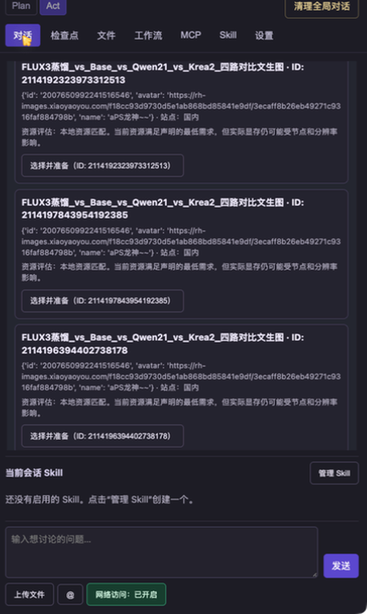
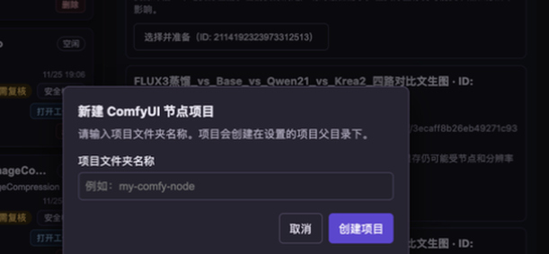
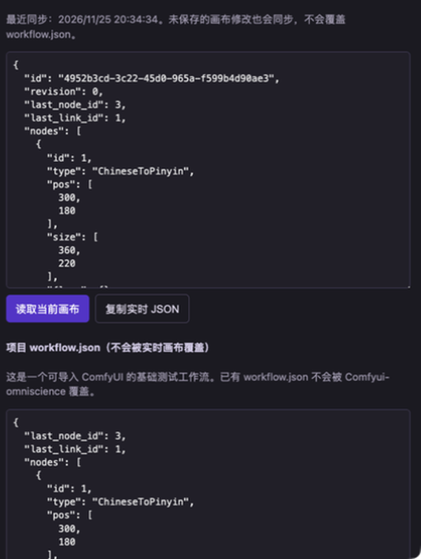

# ComfyUI Omniscience

**一个直接运行在 ComfyUI 里的 AI 编程助手。**

ComfyUI Omniscience 是一个 ComfyUI 自定义节点扩展，会在 ComfyUI 网页界面右侧加入 Omniscience 助手面板。你可以通过兼容 OpenAI 接口的模型检查与开发自定义节点、管理项目任务、读取实时工作流画布、搜索 ComfyUI 工作流，并准备所需依赖。

本项目直接运行在 ComfyUI 内，不需要 VS Code 或额外的编辑器扩展。

**许可协议：**[PolyForm Noncommercial 1.0.0](LICENSE) —— 源码公开，仅允许非商业使用；未经单独许可，禁止商用。

[English](README.md)

## 使用截图

<p align="center">
  
</p>

| 新建节点任务 | 查看实时工作流 |
| --- | --- |
|  |  |

## 功能

- **ComfyUI 内嵌助手**：点击左侧竖向菜单栏的 **AI 助手** 按钮即可打开侧栏。
- **兼容 OpenAI 接口**：支持 OpenAI、DeepSeek、OpenRouter、Ollama、LM Studio 及自定义兼容服务。
- **Plan / Act 双模式**：Plan 用于只读分析和制定计划；确认后再切换到 Act 执行修改。
- **项目工具**：列出、读取和搜索文件，写入文件，应用 unified diff，并在任务项目目录内执行开发命令。
- **任务恢复**：任务、消息、事件和文件快照保存在 SQLite 中，ComfyUI 重启后仍可恢复。
- **检查点**：查看文件变更，并从快照恢复项目文件。
- **接管已有节点**：发现 `custom_nodes` 下的项目，先查看安全检测结果，再作为可编辑任务接管。
- **实时画布集成**：在工作流页或通过 `get_current_workflow` 工具读取当前 ComfyUI 画布，包含尚未保存的修改。
- **工作流发现与准备**：搜索 RunningHub、检查所选工作流、识别缺失节点与模型，在用户逐步确认后安装或下载，并进行运行诊断。
- **安全上传工作流**：把上传的工作流 JSON 安装到 ComfyUI 用户工作流目录，不执行工作流，也不覆盖已有文件。
- **Skill 管理**：创建、启用、导入、导出和复用提示词指令包，支持静态检测与可选的 AI 辅助审核。
- **可选集成**：支持 stdio / HTTP MCP；安装 Playwright 后可启用浏览器自动化。
- **上下文压缩**：提示词长度达到配置阈值时，自动摘要较早的对话上下文。

## 环境要求

- 可正常使用的 [ComfyUI](https://github.com/comfyanonymous/ComfyUI)。
- Python 3.10 或更高版本。
- 兼容 OpenAI Chat Completions 的接口地址和模型名称。
- 托管模型服务通常需要 API Key；Ollama、LM Studio 等本地服务可以留空。
- 可选：Playwright 及其 Chromium 浏览器，用于浏览器工具。
- 可选：可信的 MCP 服务器，用于 MCP 工具。

后端复用 ComfyUI 已有的 `aiohttp` 环境。前端是原生 JavaScript 和 CSS，无需执行 npm 构建。本仓库不会自动安装 Python 依赖。

## 安装

### 手动安装

把本目录复制到 ComfyUI 的 `custom_nodes` 目录：

```bash
cp -R /path/to/Comfyui-omniscience \
  /path/to/ComfyUI/custom_nodes/Comfyui-omniscience
```

如果已经克隆了仓库，请在仓库的上级目录执行。安装完成后重启 ComfyUI，左侧竖向菜单栏会出现 **AI 助手** 按钮。

### 使用 Git 安装

```bash
git clone <repository-url> Comfyui-omniscience
cp -R Comfyui-omniscience /path/to/ComfyUI/custom_nodes/
```

请把 `<repository-url>` 替换为你的仓库或镜像地址。除非确实需要修改节点目录名称，否则建议保留 `Comfyui-omniscience` 目录名。

### 可选：安装 Playwright

在 ComfyUI 实际使用的 Python 环境中安装 Playwright，然后安装 Chromium：

```bash
/path/to/ComfyUI/.venv/bin/python -m pip install playwright -i https://mirrors.aliyun.com/pypi/simple/
/path/to/ComfyUI/.venv/bin/python -m playwright install chromium
```

便携版 ComfyUI 请按实际情况调整 Python 路径。浏览器自动化不是必需功能，不安装 Playwright 也可以使用其他功能。

## 快速开始

1. 安装扩展并重启 ComfyUI。
2. 点击左侧竖向菜单栏的 **AI 助手**。
3. 打开 **设置**，填写：
   - **Provider** 和 **API 地址**，例如 `https://api.openai.com/v1` 或 `http://127.0.0.1:11434/v1`；
   - **模型**，以及托管服务需要的 **API Key**；
   - **最大上下文 Token 数**和**自动压缩阈值**；
   - **工作区目录**，即新任务项目的父目录；
   - **ComfyUI 目录**，填写后可上传工作流和接管已有节点。
4. 点击 **＋ 新任务**，输入项目名称并描述任务。
5. 分析阶段保持 **Plan** 模式；需要修改文件或执行命令时，再切换到 **Act**。

如果要修改已有的自定义节点项目，请点击任务列表中的 **待接管** 卡片，不要重复创建项目。接管前会执行安全检测；结论为“已阻止”时，必须在面板中明确确认才能继续。

## 使用示例

### 开发自定义节点

```text
检查我的自定义节点，说明输入和输出是如何注册的。
找到 forward 方法中的错误，并提出最小修复方案。
```

确认计划后切换到 Act：

```text
应用刚才确认的修复，并运行项目测试。
```

### 检查实时工作流

```text
读取我当前的 ComfyUI 画布，总结已连接的节点。
不要修改工作流。
```

### 查找并准备工作流

```text
帮我在 RunningHub 搜索 moss 文生图工作流。
```

选择结果后检查工作流和缺失依赖。安装节点、下载模型和执行工作流是独立步骤，每一步都需要你确认。工作流搜索和下载需要开启网络访问。

### 安全安装工作流 JSON

上传 `.json` 工作流文件后发送：

```text
安装刚才上传的工作流文件。
```

也可以在输入框中选择 `@workflow`。该操作只会校验并复制文件到 `ComfyUI/user/default/workflows`，**不会**执行工作流、安装节点、下载模型或覆盖同名文件。

### 复用 Skill

打开 **Skill** 页面，创建可复用的指令集，并在对话中选用。Skill 会作为提示词注入；导入或 AI 生成的内容属于不可信指令，仍应人工检查。

## 配置

设置保存在：

```text
~/.config/comfyui-omniscience/config.json
```

在 Windows 上，配置使用 `%APPDATA%\\comfyui-omniscience\\config.json`，MCP 配置使用同一应用数据目录；任务历史和 Skill 等本地数据使用 `%LOCALAPPDATA%\\comfyui-omniscience\\`。POSIX 路径保持不变。扩展在 POSIX 上使用 `0600`，在 Windows 上通过 `icacls` 移除继承权限并限制到当前账户。设置接口不会返回 API Key。

### 环境变量

| 变量 | 用途 |
| --- | --- |
| `OMNISCIENCE_API_KEY` | 模型服务 API Key |
| `OMNISCIENCE_MODEL` | 默认模型名称 |
| `OMNISCIENCE_API_BASE_URL` | 兼容 OpenAI 的 API 基础地址 |
| `OMNISCIENCE_WORKSPACE` | 任务项目的父目录 |
| `OMNISCIENCE_COMFYUI_DIRECTORY` | ComfyUI 根目录 |
| `OMNISCIENCE_CONFIG_FILE` | 自定义配置文件路径 |
| `OMNISCIENCE_STATE_DIRECTORY` | 自定义本地数据目录 |

示例：

```bash
export OMNISCIENCE_API_KEY='your-key'
export OMNISCIENCE_MODEL='your-model'
export OMNISCIENCE_API_BASE_URL='https://api.openai.com/v1'
export OMNISCIENCE_WORKSPACE="$HOME/ComfyUI-projects"
export OMNISCIENCE_COMFYUI_DIRECTORY='/path/to/ComfyUI'
```

环境变量优先于已保存的默认配置。Provider 和外部服务参数可在 **设置** 页面调整。

## 安全边界

使用 Act 模式或接管第三方代码前，请务必阅读本节。

- **这不是操作系统级沙箱。** 文件路径限制在任务项目内，但执行命令仍然拥有 ComfyUI 进程的权限。
- **Act 模式不会在每次工具调用前逐项征求确认。** 使用前请检查任务、模型服务、项目目录和网络访问状态。
- **API Key 和项目代码可能发送给你配置的模型服务。** 请使用可信接口，不要在提示词或项目文件中放置密钥。
- **静态安全检测只是辅助审查，不能证明代码安全。** “已阻止”结果需要人工确认，而人工确认也不代表代码绝对安全。
- **第三方节点、工作流、模型、Skill 和 MCP 服务器有自己的许可与风险。** 本项目许可不会授予这些资源的使用权。
- **不要在未增加认证层的情况下把 ComfyUI 暴露给不可信用户。** 浏览器、命令、MCP 和文件工具可能影响运行 ComfyUI 的主机。

多人或不可信环境建议通过环境变量提供 API Key，并确保 ComfyUI 只监听可信地址。

## 项目结构

```text
Comfyui-omniscience/
├── __init__.py                 # ComfyUI 扩展入口
├── omniscience_server.py       # HTTP 路由注册
├── omniscience/
│   ├── agent/                  # Agent 与项目流程
│   ├── api/                    # REST 接口
│   ├── tools/                  # 工具定义与执行
│   └── workflow_manager*.py    # 工作流发现与执行
├── web/
│   ├── omniscience.js          # 侧栏界面
│   └── omniscience.css         # 侧栏样式
├── tests/                      # 后端与前端回归测试
├── DESIGN.md                   # 架构与设计说明
└── DESIGN_WORKFLOW_INSTALL.md  # 工作流安装设计
```

## 测试

在仓库根目录运行：

```bash
python3 -m unittest discover -s tests -v
python3 -m py_compile __init__.py omniscience_server.py
```

集成测试时，请把扩展安装到 ComfyUI，重启后在侧栏中连接已配置的模型服务进行实际验证。

## 参与贡献

欢迎提交问题报告和范围明确的 Pull Request。

- 复现问题，并提供操作系统、ComfyUI 版本、Provider / 模型和相关日志。
- 提交前移除 API Key、Token、Cookie、支付信息私密项目内容。
- 后端或前端行为变更应补充回归测试。
- Pull Request 保持聚焦，并说明实际执行过哪些验证。
- 提交贡献即表示你同意按照本项目的 [PolyForm Noncommercial 1.0.0 许可协议](LICENSE) 提供该贡献。

## 许可协议

Copyright (c) 2026 Comfyui-omniscience contributors.

本项目采用 [PolyForm Noncommercial License 1.0.0](LICENSE)（`PolyForm-Noncommercial-1.0.0`）。

协议允许协议定义范围内的个人、研究、爱好、教育、慈善、公共安全、环保和政府部门等非商业用途。**未经版权持有人单独书面许可，禁止任何商业用途。**

PolyForm Noncommercial 因为限制商业使用，属于 **源码公开（source-available）** 许可，而不是 OSI 认可的传统开源协议。专利条款、违约处理、终止规则和免责声明请阅读完整 [LICENSE](LICENSE)。

<a id="support-the-project"></a>

## 支持项目

如果 ComfyUI Omniscience 对你有帮助，欢迎通过 **BNB Smart Chain（BEP-20）** 发送 USDT 支持开发：

```text
0x31babbb634bb46df0298d0edb93c1f4eaac73f85
```

转账前请再次核对网络和地址。加密货币转账通常不可撤销。

也可以使用支付宝打赏：

<p align="center">
  
</p>

请打开支付宝“扫一扫”，确认收款人信息后再付款。
